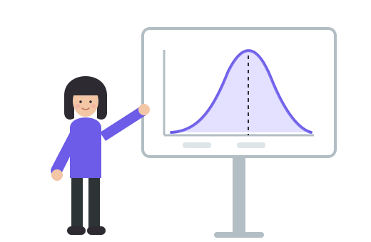

I am a Ph.D. candidate in Statistics and Data Science at the **University of Texas at Arlington**, expected to graduate in summer 2027. My dissertation develops **Bayesian models for partially observed and aggregate data**.

Before the Ph.D., I worked as a full time statistician in Canada for over three years; in summer 2026 I interned with Novartis.

* **Novartis**, Advanced Quantitative Sciences (intern, summer 2026): built a Shiny app to monitor survival data maturity across oncology trials and modelled future event timing with a piecewise exponential model.
* **Cytel**, Real World Evidence and Advanced Analytics: oncology evidence for pharma sponsors, including indirect treatment comparisons (MAIC, STC), external control arms with Bayesian borrowing, and survival analysis.
* **ERM**: multivariate models for environmental and health risk assessments, with automated reporting in Shiny and R Markdown.

I hold an M.Sc. in Statistics from **Simon Fraser University** (2019) and a B.Sc. in Applied Statistics with Distinction from the **University of Toronto** (2017).

Research Interests
======

  
<svg class="interest-icon" viewBox="0 0 24 24" aria-hidden="true"><circle cx="12" cy="5" r="2.5"/><circle cx="5.5" cy="18" r="2.5"/><circle cx="18.5" cy="18" r="2.5"/><path d="M10.8 7.2 6.7 15.8M13.2 7.2l4.1 8.6"/></svg><h3>Bayesian Hierarchical Models</h3>
MCMC based inference for partially observed and aggregate data, including Bayesian aggregation of peer and self rankings.

  
<svg class="interest-icon" viewBox="0 0 24 24" aria-hidden="true"><path d="M12 3v18M7 21h10M4 7h16"/><path d="M4 7l-2.5 6a3 3 0 0 0 5 0L4 7zM20 7l-2.5 6a3 3 0 0 0 5 0L20 7z"/></svg><h3>Comparative Effectiveness</h3>
Indirect treatment comparisons (MAIC, STC) and external control arms for oncology submissions.

  
<svg class="interest-icon" viewBox="0 0 24 24" aria-hidden="true"><rect x="13" y="6" width="8" height="12" rx="1.5"/><path d="M3 9h7M7 6l3 3-3 3M3 15h7M7 12l3 3-3 3"/></svg><h3>Bayesian Borrowing</h3>
Augmenting external and synthetic control arms with historical information, and the variance versus bias trade offs involved.

  
<svg class="interest-icon" viewBox="0 0 24 24" aria-hidden="true"><path d="M3 3v18h18"/><path d="M6 6h4v4h3v3h3v3h3"/></svg><h3>Survival Analysis</h3>
Survival models in oncology trials and a Bayesian predictive index for survival data analysis readiness.

  
<svg class="interest-icon" viewBox="0 0 24 24" aria-hidden="true"><path d="M3 21h18"/><rect x="5" y="13" width="3" height="5"/><rect x="10.5" y="9" width="3" height="9"/><rect x="16" y="5" width="3" height="13"/></svg><h3>Simulation and Power</h3>
Monte Carlo evaluation of methods and simulation based power analysis for GLMMs and GAMMs.

  
<svg class="interest-icon" viewBox="0 0 24 24" aria-hidden="true"><path d="M8 7l-5 5 5 5M16 7l5 5-5 5M14 4l-4 16"/></svg><h3>Statistical Software</h3>
R, Shiny and R Markdown tooling for reproducible analyses and interactive reporting; working SAS and Python.

Latest News
======

<ul class="news-list">

  <li>{{ post.date | date: "%b %Y" }} <a href="{{ post.url | relative_url }}" title="{{ post.title | escape }}">{{ post.headline | default: post.title }}</a></li>

</ul>

[See all news →](/year-archive/)

Where I've Studied and Worked
======


